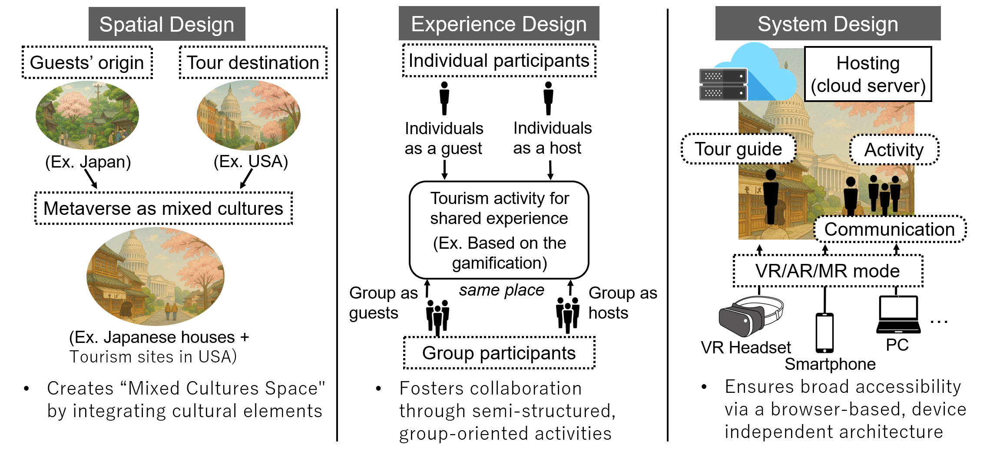

## Knowledge Expansion via Daily Surroundings with AR

- Aims to broaden interest toward unfamiliar fields, starting from familiar objects and surroundings encountered in daily life
- Explores AR presentation of related knowledge based on environmental information and user preferences and interests
- Focuses on designing presentations that bridge the strange and the familiar

**Related publications:**

- [環境情報とユーザ嗜好に基づくARを用いた知識拡張手法の検討](/publications/)
- [Bridging Strange and Familiar: Design of Knowledge Expansion System via Daily Surroundings](/publications/)

## Metaverse Tourism System: MetaUniTour

- Addressed key challenges in conventional metaverse tourism: **experience disparity**, **lack of social interaction**, and **high participation barriers**
- Designed a **cultural fusion space** that blends the cultural backgrounds of both guides and participants
- Realized **semi-structured collaborative experiences** balancing individual exploration with cooperative activities
- Adopted a **browser-based design** requiring no dedicated hardware to lower participation barriers

**Related publications:**

- [MetaUniTour: 文化融合と共有体験を実現するメタバース観光システム](/publications/)
- [MetaUniTour: Enhancing Engagement and Intercultural Understanding through A Metaverse Tourism Platform](/publications/)
